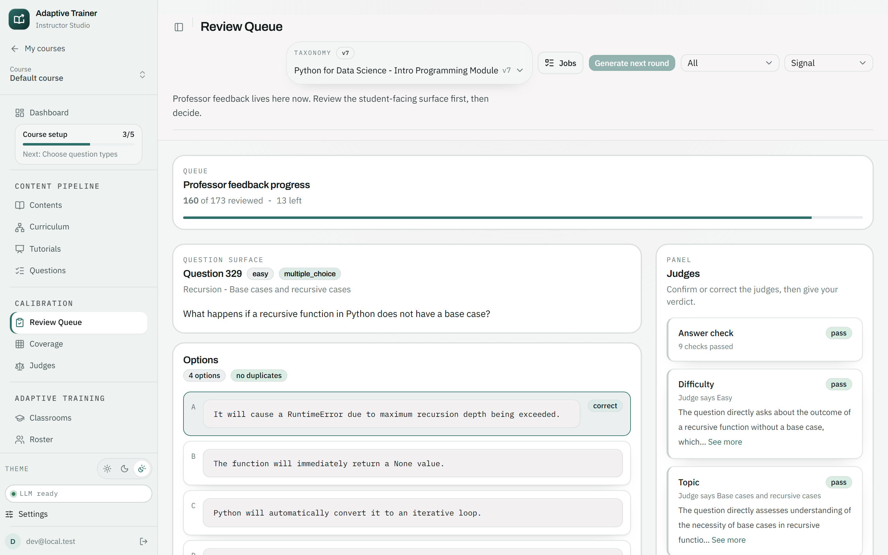
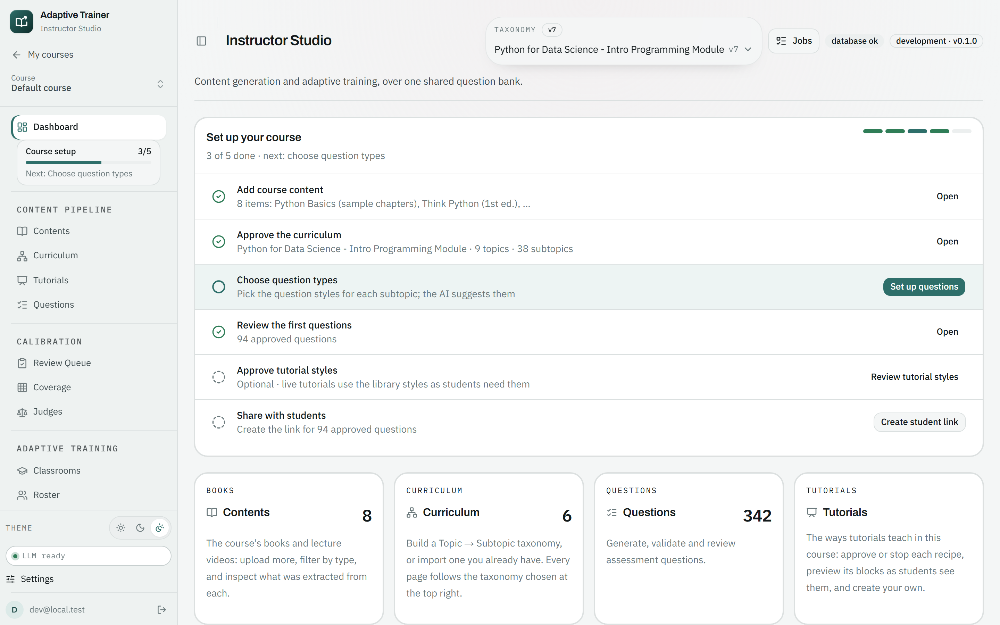
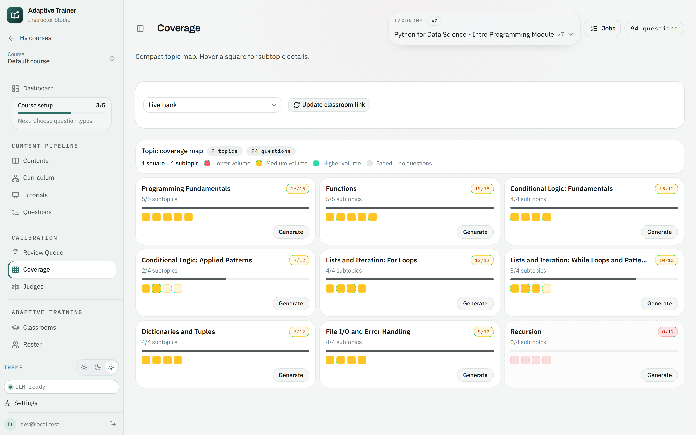

<p align="center">
  
</p>

<h1 align="center">Universal Adaptive Trainer</h1>

<p align="center">
  Build an adaptive course from your own material. AI drafts the curriculum, tutorials<br>
  and questions, learns your standards from your reviews, and adapts practice to each student.
</p>

<p align="center">
  <a href="#getting-started">Getting started</a> ·
  <a href="docs/SETUP.md">Setup</a> ·
  <a href="docs/DEPLOYMENT.md">Deployment</a> ·
  <a href="docs/LOCAL_DEVELOPMENT.md">Local development</a> ·
  <a href="../../issues">Issues</a>
</p>

<p align="center">
  
</p>

## Features

- Import books, PDFs, slides and YouTube lectures, and organize them into topics and subtopics.
- Generate questions from your own material: multiple choice, true/false, Parsons problems,
  code completion, coding, debugging, output prediction, numeric and equation answers.
- Check every question automatically. Code is run, numeric answers are compared with units,
  formulas are compared symbolically, and a panel of AI judges rates difficulty and topic fit.
- Review questions in one queue. Your accept and reject decisions teach the generator and the
  judges for the next round.
- Share a link with your class. Students sign in with a name and email, and each answer
  updates their mastery of that topic, which decides the next question.
- Live tutorials and a coverage view show which topics a question set teaches and tests.
- Works with intro Python, physics, machine learning and biology courses out of the box,
  or any subject you define.

<p align="center">
  
  
</p>

## Getting started

The quickest way to run it is with Docker:

```bash
git clone https://github.com/Amitdutta121/Universal_adaptive_trainer.git
cd Universal_adaptive_trainer
docker compose up --build
```

Open [http://localhost:3000](http://localhost:3000) and sign in with `dev@local.test` /
`devpassword123`. This account exists only in development.

To run it without Docker, install the backend and the frontend once (see
[docs/SETUP.md](docs/SETUP.md)), then start each in its own terminal:

```bash
python -m app          # backend, from the activated .venv
cd frontend && pnpm dev   # frontend
```

[docs/SETUP.md](docs/SETUP.md) has step-by-step instructions for Windows, Linux, macOS and
Docker, the list of supported model providers (OpenRouter, OpenAI, Anthropic, Azure OpenAI,
xAI, DeepSeek, or any OpenAI-compatible server such as vLLM or Ollama), and how to run student
code in a sandbox before you open the app to a class.

To put it on a server for a class, follow [docs/DEPLOYMENT.md](docs/DEPLOYMENT.md): one Linux
machine, Docker, and automatic HTTPS.

## Development

```powershell
# backend tests and lint
.\.venv\Scripts\python.exe -m pytest
.\.venv\Scripts\python.exe -m ruff check .

# frontend type check, lint and tests
cd frontend
pnpm tsc --noEmit
pnpm biome lint src
pnpm vitest run
```

Tests that call a real model are skipped by default because they cost money. Run them with
`pytest -m integration`.

## Built with

FastAPI, SQLAlchemy and Alembic on the backend; Next.js, React, TanStack Query and Tailwind on
the frontend. It uses SQLite locally and is written to run on PostgreSQL.

## License

No license has been chosen yet. PDF import uses PyMuPDF, which is licensed under AGPL-3.0.
