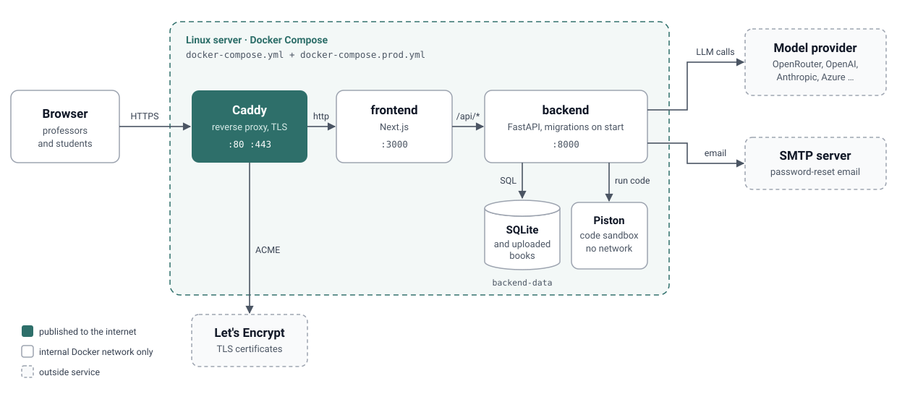

# Deployment

This guide puts Universal Adaptive Trainer on one Linux server with Docker. When you finish,
the app is served over HTTPS at your domain, and student code runs in a sandbox.

<p align="center">
  
</p>

Only Caddy is reachable from the internet. Caddy gets and renews the TLS certificate on its
own. The backend, frontend and sandbox talk over Docker's internal network. All of this is
defined in [`docker-compose.yml`](../docker-compose.yml) plus the production overrides in
[`docker-compose.prod.yml`](../docker-compose.prod.yml).

For running the app on your own computer, see [SETUP.md](SETUP.md) instead.

## What you need

- A Linux server (Ubuntu 22.04 or 24.04 is assumed below) with at least **2 CPUs, 4 GB RAM
  and 20 GB disk**. Any provider works: Hetzner, DigitalOcean, AWS Lightsail, a university VM.
- A domain or subdomain you control, for example `trainer.example.edu`.
- An API key for one model provider (see [SETUP.md](SETUP.md#model-providers)).
- An SMTP account for password-reset email (optional, see step 4).

## 1. Point your domain at the server

At your DNS provider, add an **A record** for `trainer.example.edu` with the server's public
IP address. Check that it resolves before going on, because Caddy needs it to get a certificate:

```bash
dig +short trainer.example.edu   # prints the server's IP
```

## 2. Prepare the server

SSH in, install Docker, and open only SSH, HTTP and HTTPS:

```bash
curl -fsSL https://get.docker.com | sudo sh
sudo usermod -aG docker $USER      # log out and back in after this

sudo ufw allow OpenSSH
sudo ufw allow 80
sudo ufw allow 443
sudo ufw enable
```

Check that Docker works and uses cgroup v2, which the sandbox requires:

```bash
docker info --format '{{.CgroupVersion}}'   # must print 2
```

## 3. Get the code

```bash
git clone https://github.com/Amitdutta121/Universal_adaptive_trainer.git
cd Universal_adaptive_trainer
```

## 4. Configure

```bash
cp .env.example .env
nano .env
```

Set at least these values. Anything you leave out keeps its default from `.env.example`.

```dotenv
# Your domain, without https://
DOMAIN=trainer.example.edu

# A long random value. Generate one with:  openssl rand -base64 32
AUTH_SECRET_KEY=paste-the-generated-value-here

# Your model provider (pick one; see docs/SETUP.md for the full list)
LLM_ROUTE=openrouter
LLM_API_KEY=sk-or-v1-...

# Anyone with the URL can register, so keep model settings to admins
MODEL_SETTINGS_ADMIN_ONLY=true

# Password-reset email
SMTP_HOST=smtp.example.edu
SMTP_PORT=587
SMTP_USER=...
SMTP_PASSWORD=...
SMTP_FROM=Adaptive Trainer <no-reply@example.edu>
```

If you don't have SMTP yet, set `EMAIL_BACKEND=console` instead of the `SMTP_*` lines.
Emails, including reset links, are then written to the backend log and never sent.

You don't need to set `ENVIRONMENT`, `PUBLIC_APP_URL`, `EXECUTOR` or the ports.
`docker-compose.prod.yml` sets them from `DOMAIN`.

The backend refuses to start in production if `AUTH_SECRET_KEY` is missing or too short, or if
SMTP is half configured. The log names the setting at fault (see step 5).

## 5. Start the app

```bash
docker compose -f docker-compose.yml -f docker-compose.prod.yml up -d --build
```

The first build takes 5 to 10 minutes. Then check that all four containers are up:

```bash
docker compose -f docker-compose.yml -f docker-compose.prod.yml ps
```

`backend`, `frontend`, `caddy` and `piston` should each show `Up`. If one keeps restarting,
read its log, for example:

```bash
docker compose -f docker-compose.yml -f docker-compose.prod.yml logs --tail 50 backend
```

To save typing, define an alias for the rest of this guide:

```bash
alias uat='docker compose -f docker-compose.yml -f docker-compose.prod.yml'
```

## 6. Install the sandbox's Python runtime

Do this once. The runtime is kept in a Docker volume and survives restarts.

```bash
uat exec backend python -c "import httpx; print(httpx.post('http://piston:2000/api/v2/packages', json={'language': 'python', 'version': '3.12.0'}, timeout=600).text)"
```

It prints `{"language":"python","version":"3.12.0"}` after about 30 seconds.

## 7. Create the first account

No account is seeded in production. Create yours, then enter the password when prompted:

```bash
uat exec backend python -m app.auth.create_user --email you@example.edu --superuser
```

## 8. Check it

```bash
curl https://trainer.example.edu/api/health
```

This should return `"status":"ok"`, `"environment":"production"` and `"database_ok":true`.
Then open `https://trainer.example.edu` in a browser, sign in with the account from step 7,
and open **Settings → Providers** to confirm your model provider shows as configured.

## Updating

```bash
cd Universal_adaptive_trainer
git pull
uat up -d --build
```

Database migrations run automatically when the backend starts. Back up first (below) so you
can roll back.

## Backups

Everything worth keeping (the database and uploaded books) is in the `backend-data` volume.
Copy the database out while the app is running:

```bash
uat exec backend python -c "import sqlite3; sqlite3.connect('data/adaptive_trainer.db').backup(sqlite3.connect('data/backup.db'))"
uat cp backend:/app/data/backup.db ./backup-$(date +%F).db
```

To include uploaded books, archive the whole volume:

```bash
docker run --rm -v universal_adaptive_trainer_backend-data:/data -v "$PWD":/backup alpine \
  tar czf /backup/uat-data-$(date +%F).tgz -C /data .
```

The volume name is your folder name in lowercase, then `_backend-data`. Run
`docker volume ls` if you're unsure. Keep backups somewhere other than the server.

To restore an archive, stop the app, unpack it into the volume, and start again:

```bash
uat down
docker run --rm -v universal_adaptive_trainer_backend-data:/data -v "$PWD":/backup alpine   sh -c "rm -rf /data/* && tar xzf /backup/uat-data-2026-11-01.tgz -C /data"
uat up -d
```

## Day-to-day commands

| Task | Command |
| --- | --- |
| Status | `uat ps` |
| Follow the backend log | `uat logs -f backend` |
| Restart after editing `.env` | `uat up -d` |
| Stop | `uat down` |
| Add another professor account | `uat exec backend python -m app.auth.create_user --email them@example.edu` |

Never run `uat down -v` on the server. The `-v` deletes the database volume.

## Troubleshooting

- **The browser shows a certificate error or Caddy logs `challenge failed`.** DNS doesn't
  point at this server yet, or ports 80 and 443 are blocked by a firewall at your provider.
  Fix it, then run `uat restart caddy`.
- **The backend keeps restarting.** Run `uat logs --tail 50 backend`. It names the missing
  setting, usually `AUTH_SECRET_KEY`, `DOMAIN` or an `SMTP_*` value.
- **Sign-in seems to work but you're sent back to the login page.** You opened the site over
  plain `http://` or by IP. In production the session cookie is HTTPS-only, so always use
  `https://<your domain>`.
- **Coding questions fail with an executor error.** The sandbox runtime isn't installed (step 6),
  or the `piston` container isn't running.

## Limits of this setup

- It runs on a single server with SQLite. That suits a course or a department. Running several
  backend replicas would need PostgreSQL, which isn't wired up yet.
- The Piston container is privileged, so the sandbox's isolation depends on Isolate inside it.
  Read [docker/piston/README.md](../docker/piston/README.md) before you open the app to
  untrusted users, and keep the server dedicated to this app.
- PDF import uses page-based chunking. The Docling extra isn't in the image.
